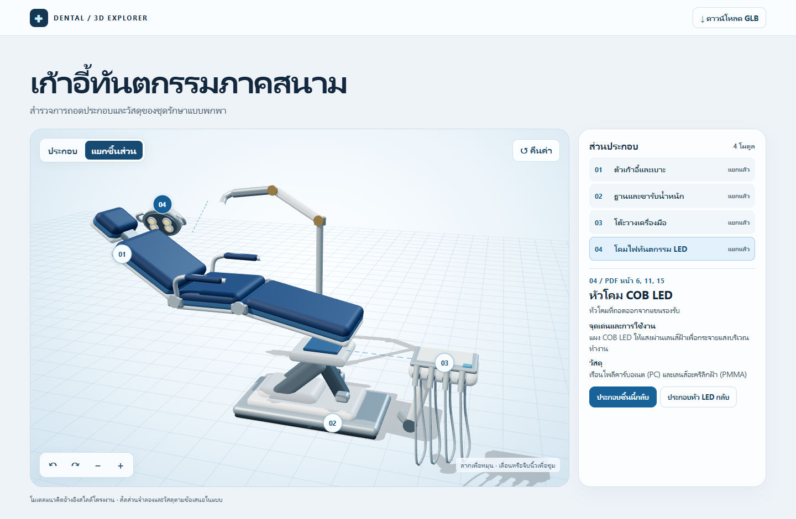

# Field dental chair 3D

Web 3D teardown prototype for a portable dental chair. Open [the viewer](dental-chair-web/index.html) from a local checkout in Chrome or Edge. The viewer runs offline and can export the assembled model as GLB for Blender.

- [Codex prototype](dental-chair-web/README.md) contains source, bundled viewer, and the maintenance skill.
- [Antigravity handoff](dental-chair-antigravity/README.md) contains the brief and [original reference PDF](dental-chair-antigravity/reference/field-dental-chair-source.pdf) for an independent implementation.
